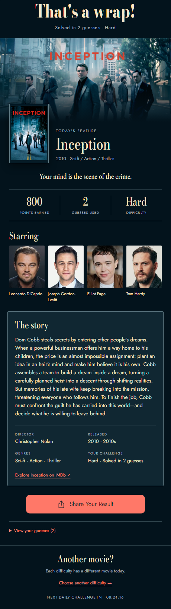
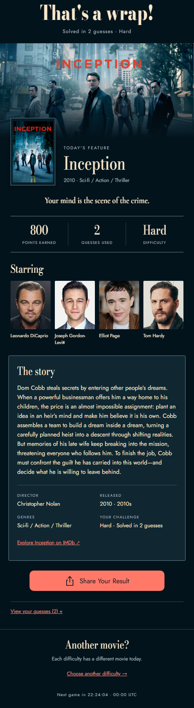

# Cinematic reward

Implements the selected **02 · Cinematic reveal** composition using the existing Premiere fonts, theme tokens and shared gameplay controls.

| Approved composition (460px content) | Implemented screen (460px content) |
| --- | --- |
|  |  |

[320px screen](implemented-320.png) · [320px light theme](implemented-light-320.png) · [Original interactive reference](reference.html)

The artwork height, overlapping poster, title, tagline, score strip, cast row and full-story card follow the reference. Real content can change the height. Accessible control targets and the existing share/countdown components introduce small spacing differences. Browser screenshots use an illustrative Inception fixture; production displays the actual saved movie and result.

## Content

New game snapshots preserve the full synopsis separately from the difficulty-specific clue. Deploy the Functions change through the normal release process to populate that field on newly created games. Existing snapshots use the presentation catalog where available, then their existing description. This does not modify clues, scoring or daily movie selection.

`node scripts/prepare-movie-rewards.cjs` regenerates the presentation catalog from tracked movie data; `--check` verifies it is current. The catalog covers 3,634 titles and adds about 2.2 MB of uncompressed JSON to the lazy gameplay bundle. Actor portraits are matched by exact movie ID and actor name. Unavailable artwork falls back to the poster or local theatre image, and missing portraits use the existing actor placeholder. See [fixture provenance](../../../integration/fixtures/reward/README.md).

## Verification

- App unit suite: 112 suites, 723 tests, 1 snapshot; coverage gates passed.
- Functions index unit suite: 18 tests passed.
- Reward catalog generator: 2 tests passed and deterministic output checked.
- TypeScript, ESLint and architecture checks passed.
- Isolated browser integration suite: 8 passed, 2 skipped. Includes actual gameplay, sharing, result reload and difficulty switching.
- Focused visual browser rerun: passed at 460, 390, 320 and 1440px, with long titles, missing images, revealed answers, unconfirmed scores and light theme.

Visual checks ran on Chromium / React Native Web. iOS and Android device rendering have not been separately verified. The browser test asserts layout and behavior and captures screenshots; it is not a pixel-diff baseline test.
